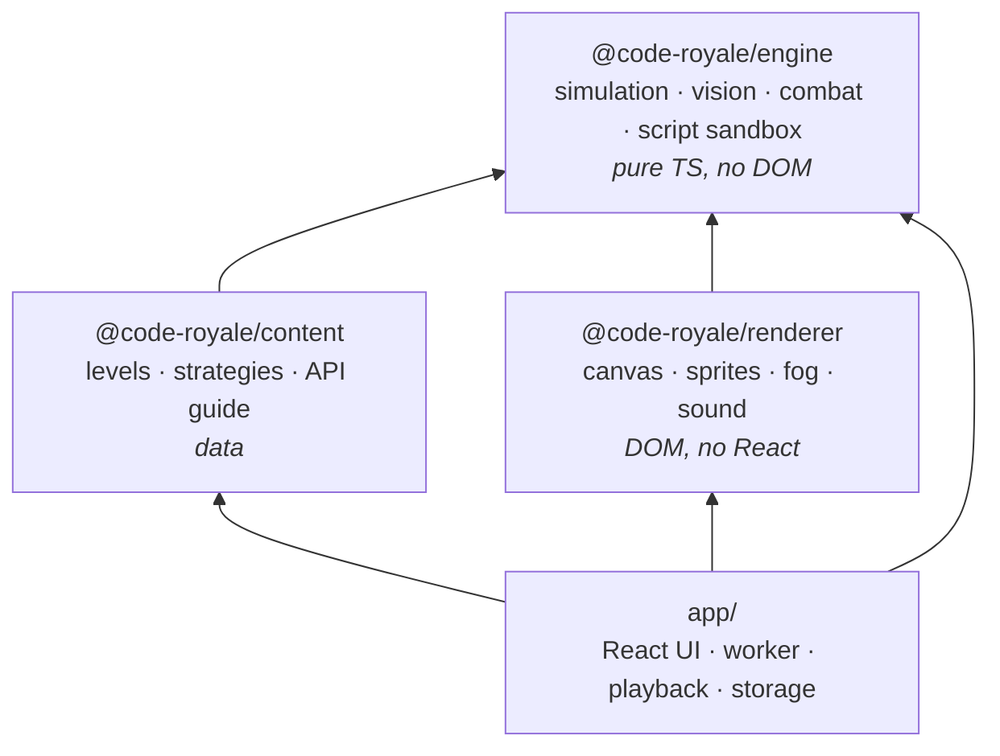
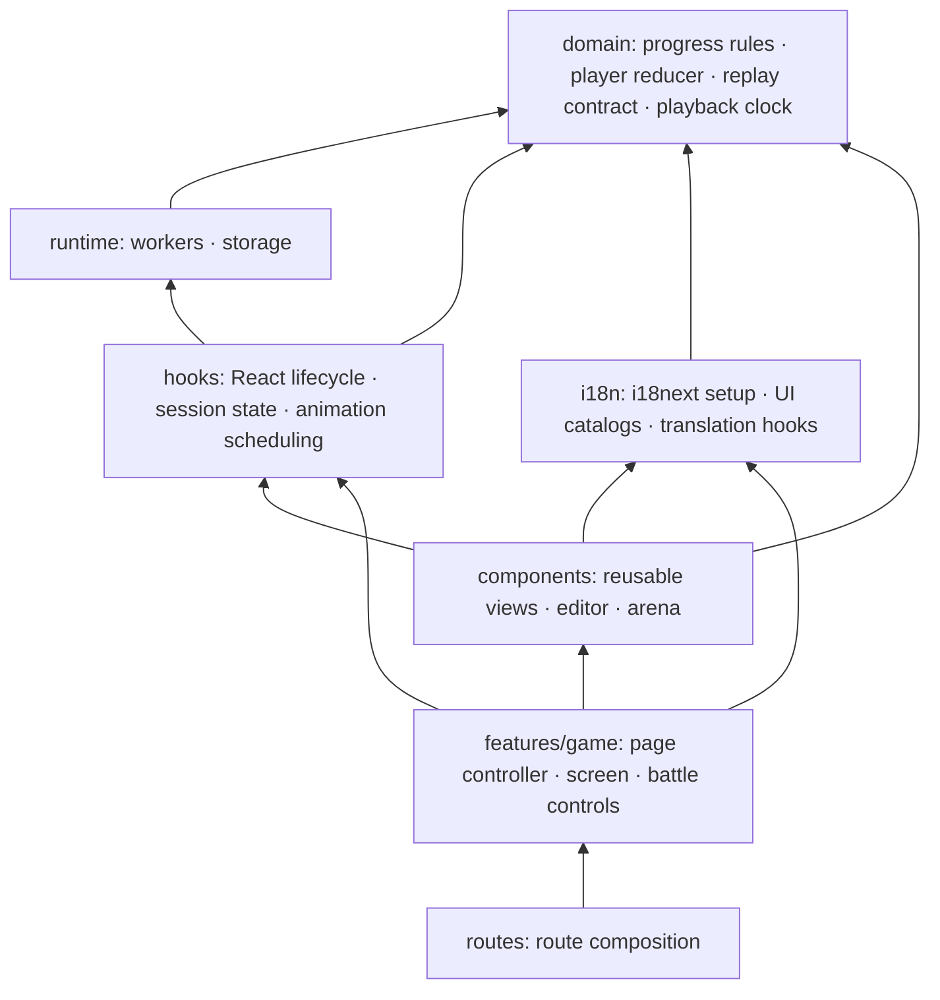
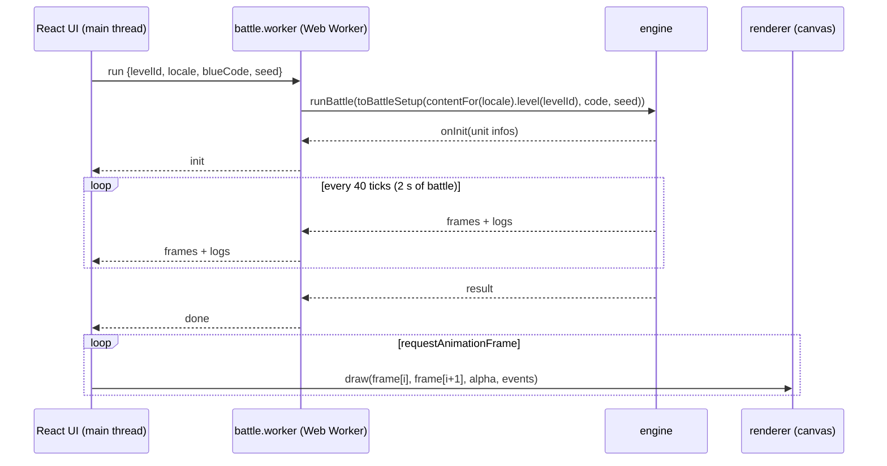

# Architecture

## Layers

| Layer | Knows about | Never knows about |
| --- | --- | --- |
| engine | itself, `acorn` | levels, pixels, browsers, React, languages (it speaks in message codes) |
| content | engine types/rules | rendering, UI |
| renderer | engine `Frame` protocol | React, levels, scripts, languages (its words are injected) |
| app | everything, via package entry points only | package internals |

The engine never imports content: a level reaches the engine only as a plain `BattleSetup`,
built by `toBattleSetup(level, code, seed)` (content). Content never imports the renderer, and the renderer never imports content.

## Enforcement

The rules are checked by machines, not by convention:

1. **Per-package `tsconfig.json`.** Engine and content compile with `lib: ["ES2022"]` and `types: []`,
   so any use of `window`, `document`, `console`, timers… is a compile error.
2. **`tools/check-architecture.mjs`** uses the TypeScript parser to inspect dependencies:
   allowlist per layer, no relative import leaving its package, no deep import
   (`@code-royale/x/src/...`). It includes side-effect imports, re-exports, dynamic imports,
   inline import types, `require` and worker URLs. App aliases obey the same rules as relative paths.
3. **Package entry points.** Each package exposes a single `src/index.ts` through `exports`;
   everything else is private.
4. **CI gate.** `npm run check` (typecheck ×4, architecture, tests) runs inside the Docker build;
   the image is not produced if it fails.

Packages are source-only npm workspaces (`exports` points at `.ts`); Vite, Vitest and tsx consume them
directly. No build step per package.

## Responsibilities inside the app

The existing package split is retained. Application rules, browser adapters and React presentation
have their own boundaries as well:

| Directory | Owns | Must not depend on |
| --- | --- | --- |
| `app/domain` | Pure progress rules, player state transitions, read-only replay contract, playback state machine | React, storage, workers, timers, renderer, UI |
| `app/runtime` | Worker transport, watchdogs, storage decoding and persistence | React hooks, components, page features |
| `app/hooks` | React state and resource lifetimes; adapts domain rules to browser services | Components, page layout |
| `app/i18n` | The i18next instance, UI catalogs, hooks turning content, messages and renderer words into the player's language | Hooks, runtime, components, page features |
| `app/components` | Reusable UI and canvas sizing/input | Worker and storage implementations, page features |
| `app/features/game` | Coordinates use cases; renders the game page and its controls | Direct storage or worker access |
| `app/routes` | Composes the page feature | Game rules and browser adapters |

`app/domain/tsconfig.json` compiles with ES2022 and no DOM or ambient types. Reducers and
state machines can therefore be exercised in Node without mounting React or creating a browser.
The import checker enforces every row above. The app root owns global styles, theme and router layout.

`BattleRun` implements `BattleReplay`. Arena and debugger consume that read-only contract,
so presentation has no dependency on how frames were produced. `BattlePlayback` owns only the
playback cursor, phases and event dispatch decisions. Its updates describe render/audio effects;
`useArenaPlayback` schedules animation frames and applies those effects.

The player reducer commits the outgoing draft before changing levels. Persistence runs in effects,
outside React state updaters. A battle session owns and disposes its worker; cancelled runs ignore
queued messages. Awards are recorded once per run, while replays and debugger seeks reuse the award.

## Responsibilities inside the renderer

`ArenaRenderer` composes layers and interpolates frames; the package API remains unchanged.

| Module | Responsibility |
| --- | --- |
| `terrain.ts` | Cached ground, bushes, rocks and walls |
| `fog.ts` | Reusable visibility masks and rock shadows |
| `effects.ts` | Event-derived animation state, particles, tombstones, banners and sound dispatch |
| `unit-overlays.ts` | Health bars, decision icons, targets, sight circles and hover information |
| `hud.ts` | Team totals and battle clock |
| `view.ts`, `canvas.ts` | Renderer contracts, visual constants and drawing helpers |
| `sprites.ts`, `audio.ts` | Procedural sprites and synthesized audio |

Draw order and the shared seeded animation RNG are preserved. Simulation state remains entirely
inside the engine; renderer effects never feed back into it.

## Runtime data flow

- The whole battle is simulated **ahead of time**, far faster than playback (a full battle takes tens of milliseconds).
  The UI replays the buffered frames at 1×/2×/4×, with slow motion on the final blow.
- **Infinite loops:** the page kills the worker if no message arrives for 2 s (`BattleRun` watchdog).
- Replays, speed changes and "skip to end" are free: they only move the playback cursor.

## Data contract (`packages/engine/src/protocol.ts`)

| Type | Direction | Notes |
| --- | --- | --- |
| `BattleSetup` | in | armies (`SpawnSpec[]`), terrain (`Circle[]` bushes/rocks), items, scripts, `timeLimit`, `waves`/`endless`, `seed` |
| `UnitInfo` | out, once | static per fighter: id, type, team, name, maxHp, radius |
| `Frame` | out, per tick | `units: UnitSnap[]`, `projectiles`, `items`, `events: GameEvent[]` |
| `GameEvent` | out | discrete happenings for effects/sound: `hit`, `death`, `swing`, `shoot`, `spotted`, `lost`, `smoke`, `wave`… |
| `LogEntry` | out | player-facing console lines: `log()` text, or a friendly error/warning as a `Message` (code + params, see [i18n.md](i18n.md)) |
| `BattleResult` | out, once | winner, time, survivors, kills, damage, waves cleared, `said` |
| `TraceRequest` / `TraceReply` | debugger | which tick and fighter (+ breakpoints) → a `Trace`: steps with location, depth, `Inspected` variables, order so far |

All plain JSON: it crosses the worker boundary by structured clone, and a battle could be saved as a replay.
